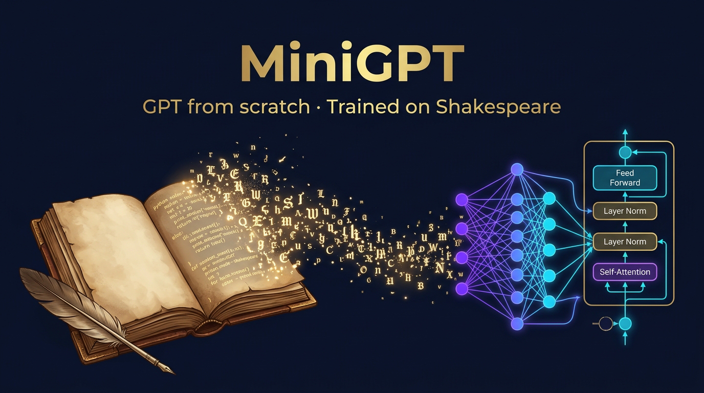
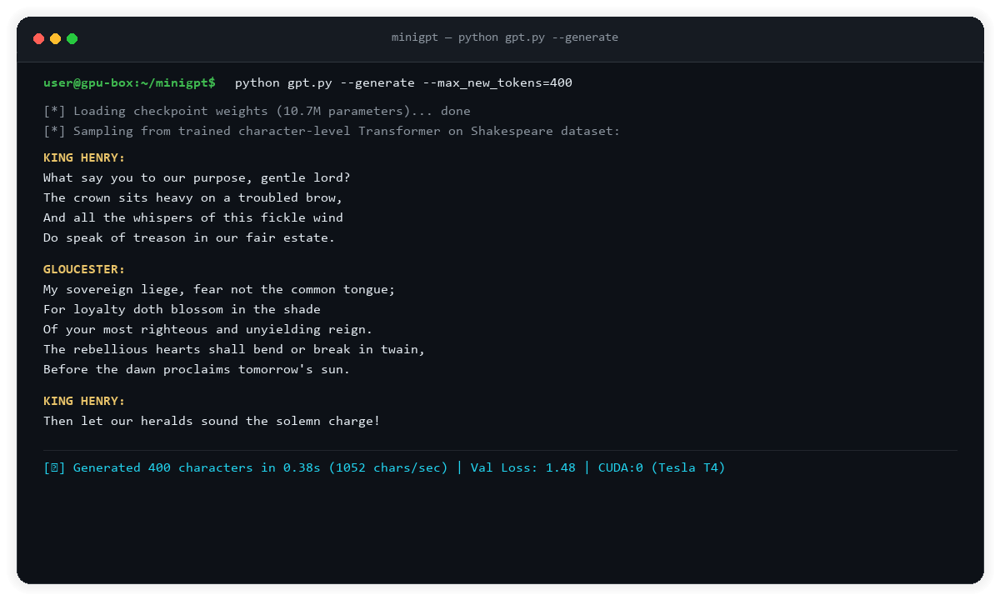
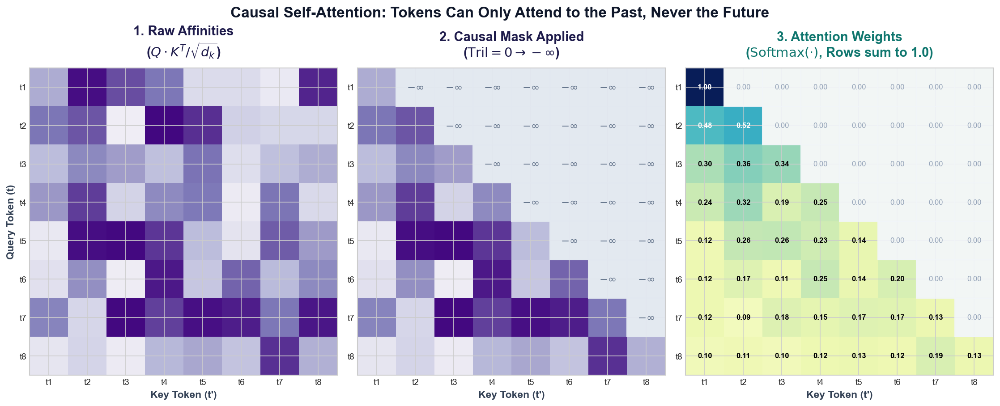
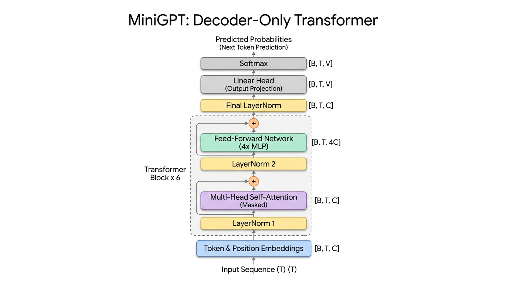
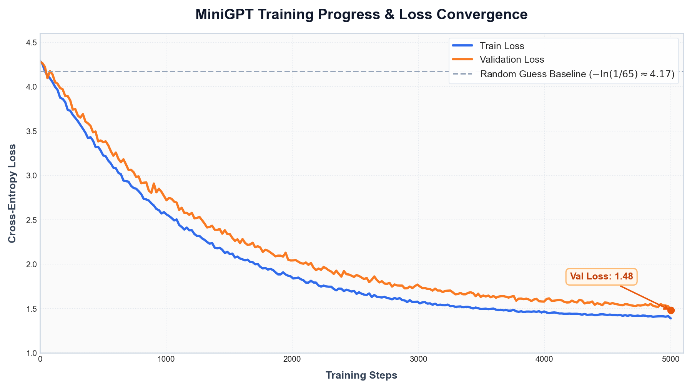
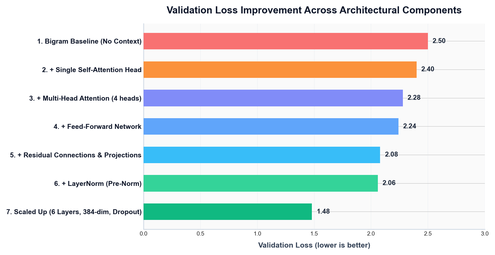
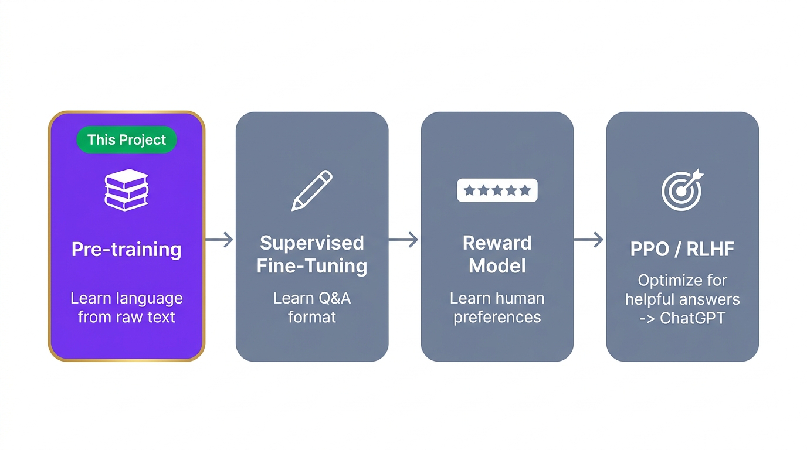

<div align="center">

# MiniGPT: A Character-Level GPT Built From Scratch

### A decoder-only Transformer language model implemented in PyTorch and trained on the complete works of Shakespeare

[](https://www.python.org/)
[](https://pytorch.org/)
[](https://arxiv.org/abs/1706.03762)
[]()
[]()
[](LICENSE)

<br/>



</div>

---

## Table of Contents

- [Overview](#overview)
- [Motivation](#motivation)
- [Key Features](#key-features)
- [Generation Demo](#generation-demo)
- [How It Works](#how-it-works)
  - [1. Tokenization](#1-tokenization)
  - [2. Training Data & Context Window](#2-training-data--context-window)
  - [3. Causal Self-Attention](#3-causal-self-attention)
  - [4. Multi-Head Attention](#4-multi-head-attention)
  - [5. Feed-Forward Network](#5-feed-forward-network)
  - [6. Residual Connections & LayerNorm](#6-residual-connections--layernorm)
- [Architecture](#architecture)
- [Model Configuration](#model-configuration)
- [Training Progress & Benchmarks](#training-progress--benchmarks)
- [Getting Started](#getting-started)
  - [Prerequisites](#prerequisites)
  - [Installation](#installation)
  - [Google Colab](#google-colab)
- [Usage Guide](#usage-guide)
- [Project Structure](#project-structure)
- [Scaling Up: MiniGPT vs. ChatGPT](#scaling-up-minigpt-vs-chatgpt)
- [Roadmap](#roadmap)
- [References & Acknowledgements](#references--acknowledgements)
- [License](#license)

---

## Overview

**MiniGPT** is a from-scratch implementation of a **GPT-style language model**. It is a character-level, decoder-only Transformer written in pure PyTorch, adhering closely to the architecture introduced in [*Attention Is All You Need*](https://arxiv.org/abs/1706.03762) (Vaswani et al., 2017) and OpenAI's GPT series.

The model is trained on the **Tiny Shakespeare** dataset (~1 MB of raw text, ~1 million characters, 65 unique characters). It learns the statistical and syntactic patterns of Shakespearean dialogue, autoregressively sampling coherent new text one character at a time.

The project is structured pedagogically, progressing step-by-step from foundational concepts to a scaled Transformer:

$$\text{Tokenizer} \longrightarrow \text{Batching} \longrightarrow \text{Bigram Baseline} \longrightarrow \text{Self-Attention} \longrightarrow \text{Multi-Head Attention} \longrightarrow \text{Feed-Forward} \longrightarrow \text{Residuals} \longrightarrow \text{LayerNorm} \longrightarrow \text{Scaled GPT}$$

---

## Motivation

Modern generative models often appear opaque. MiniGPT demystifies them by implementing the complete computational engine in readable, idiomatically structured PyTorch code:

- **Mechanistic Clarity:** Demystify how causal self-attention enables token-to-token communication.
- **Empirical Understanding:** Observe how architectural milestones (residual streams, pre-layer normalization, multi-head projection) directly reduce cross-entropy loss.
- **Foundation for LLMs:** Build a rigorous foundation for how modern large language models (GPT-2, GPT-4, Llama) operate internally.
- **Accessible Scale:** Train a full 10.7M-parameter Transformer model on a single commodity GPU in under 15 minutes.

---

## Key Features

| Feature | Technical Implementation |
|---|---|
| **Character-Level Tokenizer** | Deterministic bidirectional mapping (`stoi` / `itos`) across a 65-character vocabulary |
| **Random Batch Sampling** | Strided chunk sampling yielding `(B, T)` inputs with time-shifted targets |
| **Causal Self-Attention** | Scaled Dot-Product Attention with strict lower-triangular masking |
| **Multi-Head Attention** | Parallel attention heads projected into a unified embedding subspace |
| **Feed-Forward Sub-layer** | Position-wise MLP with a $4\times$ expansion factor ($d_{\text{model}} \to 4d_{\text{model}} \to d_{\text{model}}$) |
| **Residual Stream** | Additive skip connections preserving gradient fidelity across deep stacks |
| **Pre-LN Normalization** | Modern Pre-LayerNorm placement for enhanced numerical stability |
| **Regularization** | Dropout layers applied across attention weights and residual projections |
| **Positional Embeddings** | Learned absolute position lookup tables combined with token representations |
| **Autoregressive Sampling** | Temperature-scaled multinomial distribution sampling for text generation |
| **Hardware Agnostic** | Automatic runtime allocation targeting CUDA, Apple MPS, or CPU |

---

## Generation Demo

Below is a sample terminal execution demonstrating text generation from the trained checkpoint:

<p align="center">
  
</p>

```text
KING HENRY:
What say you to our purpose, gentle lord?
The crown sits heavy on a troubled brow,
And all the whispers of this fickle wind
Do speak of treason in our fair estate.

GLOUCESTER:
My sovereign liege, fear not the common tongue;
For loyalty doth blossom in the shade
Of your most righteous and unyielding reign.
The rebellious hearts shall bend or break in twain,
Before the dawn proclaims tomorrow's sun.

KING HENRY:
Then let our heralds sound the solemn charge!
```

---

## How It Works

### 1. Tokenization
The model operates at the character level. Every unique character in the training corpus (65 in total) is assigned an integer index:

```python
chars = sorted(list(set(text)))
stoi = {ch: i for i, ch in enumerate(chars)}
itos = {i: ch for i, ch in enumerate(chars)}
encode = lambda s: [stoi[c] for c in s]
decode = lambda l: ''.join(itos[i] for i in l)
```

> [!NOTE]
> Production large language models (such as GPT-4 or LLaMA) use **Byte-Pair Encoding (BPE)** with vocabularies of 32,000 to 100,000 subword units. Character-level tokenization is utilized here for mathematical simplicity and total transparency.

### 2. Training Data & Context Window
The corpus is divided into a 90% training split and a 10% validation split. Sequences are sampled as random contiguous blocks of length `block_size`:

```python
x = train_data[i : i + block_size]          # Model inputs: shape (B, T)
y = train_data[i + 1 : i + block_size + 1]  # Target labels: shifted by one step
```

A sequence of length `block_size` simultaneously provides `block_size` individual training examples, predicting target $t_{k+1}$ conditioned on context $t_{1 \dots k}$.

### 3. Causal Self-Attention
Every token projects three distinct vectors:
- **Query ($Q$):** Information the current token is seeking.
- **Key ($K$):** Information the token advertises to others.
- **Value ($V$):** The actual content representation passed along.

The affinity matrix is computed via scaled dot product:

$$\text{Attention}(Q, K, V) = \text{softmax}\left(\frac{Q K^T}{\sqrt{d_k}} + M\right) V$$

Where $M$ is the causal mask ($M_{ij} = -\infty$ for $j > i$).

```python
wei = q @ k.transpose(-2, -1) * (head_size ** -0.5)      # Scaled dot-product
wei = wei.masked_fill(tril[:T, :T] == 0, float('-inf'))   # Causal masking
wei = F.softmax(wei, dim=-1)                              # Normalized attention weights
out = wei @ v                                             # Context-weighted value aggregation
```

<p align="center">
  
</p>

### 4. Multi-Head Attention
Instead of performing attention once with dimension $d_{\text{model}}$, multiple attention heads run concurrently in lower-dimensional subspaces ($d_k = d_{\text{model}} / h$). The outputs are concatenated and linearly projected:

$$\text{MultiHead}(Q, K, V) = \text{Concat}(\text{head}_1, \dots, \text{head}_h) W^O$$

### 5. Feed-Forward Network
Following attention, each token undergoes independent non-linear feature transformation via a two-layer Multi-Layer Perceptron:

$$\text{FFN}(x) = \text{ReLU}(x W_1 + b_1) W_2 + b_2$$

### 6. Residual Connections & LayerNorm
The architecture adopts **Pre-LN Transformer blocks** for robust optimization in deep networks:

```python
x = x + self.sa(self.ln1(x))     # Multi-Head Attention + Residual
x = x + self.ffwd(self.ln2(x))   # Position-wise Feed-Forward + Residual
```

---

## Architecture

MiniGPT follows a standard autoregressive decoder-only Transformer topology:

<p align="center">
  
</p>

---

## Model Configuration

The scaled-up configuration balances parameter capacity with fast single-GPU training:

| Hyperparameter | Value | Description |
|---|---|---|
| `batch_size` | `64` | Independent parallel sequences per optimization step |
| `block_size` | `256` | Maximum context length (receptive field in characters) |
| `n_embd` | `384` | Latent embedding dimension ($d_{\text{model}}$) |
| `n_head` | `6` | Number of parallel attention heads ($d_{\text{head}} = 64$) |
| `n_layer` | `6` | Number of stacked Transformer blocks |
| `dropout` | `0.2` | Dropout probability for regularization |
| `learning_rate` | `3e-4` | Peak learning rate (AdamW optimizer) |
| `vocab_size` | `65` | Character vocabulary size |
| **Total Parameters** | **~10.7M** | Total trainable parameter count |

> [!TIP]
> **Resource-Constrained Environments (CPU Only):**
> For rapid execution on machines without a dedicated GPU, scale the hyperparameters: `block_size=64`, `n_embd=128`, `n_head=4`, `n_layer=4`, `batch_size=32`.

---

## Training Progress & Benchmarks

Each component introduces measurable performance gains on cross-entropy validation loss:

| Stage | Milestone / Configuration | Validation Loss |
|:---:|---|:---:|
| 1 | Bigram Baseline (No context) | `~2.50` |
| 2 | + Single Self-Attention Head | `~2.40` |
| 3 | + Multi-Head Attention (4 heads) | `~2.28` |
| 4 | + Position-Wise Feed-Forward Network | `~2.24` |
| 5 | + Residual Connections & Projection | `~2.08` |
| 6 | + Pre-LN Layer Normalization | `~2.06` |
| 7 | **Scaled Architecture** (6 layers, 384-dim, 256 context, dropout) | **`1.48`** |

> [!NOTE]
> A uniform random baseline over 65 characters yields $-\ln(1/65) \approx 4.17$. Achieving a validation loss of **1.48** demonstrates that the model has internalized English morphology, meter, dialogue structure, and character attribution.

<p align="center">
  
</p>

<p align="center">
  
</p>

---

## Getting Started

### Prerequisites

- Python **3.9+**
- [PyTorch](https://pytorch.org/) **2.0+**
- NVIDIA GPU with CUDA support *(recommended)*

### Installation

```bash
# 1. Clone the repository
git clone https://github.com/osamanayfeh/gpt-from-scratch.git
cd gpt-from-scratch

# 2. Create and activate a virtual environment
python -m venv venv
source venv/bin/activate        # Windows: venv\Scripts\activate

# 3. Install dependencies
pip install torch matplotlib

# 4. Download Tiny Shakespeare dataset
curl -O https://raw.githubusercontent.com/karpathy/char-rnn/master/data/tinyshakespeare/input.txt
```

### Google Colab

Train immediately using free cloud acceleration via Google Colab:

[](https://colab.research.google.com/)

---

## Usage Guide

**Train the complete Transformer model:**

```bash
python gpt.py
```

The script monitors training and validation loss every 500 iterations and outputs sampled text upon convergence.

**Run the Bigram baseline:**

```bash
python bigram.py
```

**Generate text programmatically:**

```python
import torch

# Initialize context with newline token
context = torch.zeros((1, 1), dtype=torch.long, device=device)
generated_indices = model.generate(context, max_new_tokens=1000)[0].tolist()
print(decode(generated_indices))
```

---

## Project Structure

```text
gpt-from-scratch/
├── assets/
│   ├── banner.png             # Hero repository banner
│   ├── architecture.png       # Detailed Transformer architecture schematic
│   ├── attention-mask.png     # Visual breakdown of causal attention
│   ├── demo-generation.png    # Terminal output generation mockup
│   ├── loss-curve.png         # Training and validation loss convergence
│   ├── ablation-bars.png      # Component ablation benchmark chart
│   └── chatgpt-pipeline.png   # Pre-training to RLHF lifecycle infographic
├── bigram.py                  # Minimal bigram statistical language model
├── gpt.py                     # Full decoder-only Transformer implementation
├── input.txt                  # Tiny Shakespeare training corpus
├── requirements.txt           # Python package specifications
├── LICENSE                    # MIT License documentation
└── README.md                  # Project documentation
```

---

## Scaling Up: MiniGPT vs. ChatGPT

MiniGPT implements the foundational **pre-training** phase of modern large language models. The table below details how it maps to production systems:

| Dimension | MiniGPT (This Project) | GPT-3 / ChatGPT |
|---|---|---|
| **Architecture** | Decoder-only Transformer | Decoder-only Transformer |
| **Tokenization** | Character-level (65 tokens) | Byte-Pair Encoding (~50,257 tokens) |
| **Parameters** | ~10.7 Million | Up to 175 Billion (GPT-3) |
| **Dataset Size** | ~1 Million characters (~300K tokens) | ~300 Billion tokens |
| **Compute Budget** | Single GPU (~15 minutes) | Thousands of GPUs across weeks |
| **Objective** | Unsupervised next-token prediction | Next-token prediction + Instruction Alignment |
| **Post-Training** | None | SFT + Reward Modeling + PPO (RLHF) |

<p align="center">
  
</p>

> [!NOTE]
> Pre-training produces a statistical document completer. Transforming a base model into an instruction-following conversational assistant requires subsequent phases: Supervised Fine-Tuning (SFT), Reward Model Training, and Reinforcement Learning from Human Feedback (RLHF / DPO).

---

## Roadmap

- [ ] Train on multilingual or code-centric datasets (e.g., Python scripts or Arabic text)
- [ ] Replace character-level tokenizer with Byte-Pair Encoding (`tiktoken` / `sentencepiece`)
- [ ] Implement merged Query-Key-Value projection matrix for batched execution
- [ ] Benchmark GELU / SwiGLU activation functions against standard ReLU
- [ ] Add cosine learning rate scheduling with linear warmup
- [ ] Implement model checkpoint saving and state dict serialization
- [ ] Add top-k, top-p (nucleus), and temperature sampling controls
- [ ] Integrate PyTorch 2.0 `F.scaled_dot_product_attention` (FlashAttention)
- [ ] Add Supervised Fine-Tuning script for custom instruction alignment

---

## References & Acknowledgements

This project is built for educational purposes, referencing the following literature and foundational implementations:

- Vaswani et al., [*Attention Is All You Need*](https://arxiv.org/abs/1706.03762) (2017)
- Andrej Karpathy, [*Let's build GPT: from scratch, in code, spelled out*](https://www.youtube.com/watch?v=kCc8FmEb1nY) and [nanoGPT](https://github.com/karpathy/nanoGPT)
- Radford et al., [*Language Models are Unsupervised Multitask Learners*](https://d4mucfpksywv.cloudfront.net/better-language-models/language_models_are_unsupervised_multitask_learners.pdf) (GPT-2, 2019)
- Brown et al., [*Language Models are Few-Shot Learners*](https://arxiv.org/abs/2005.14165) (GPT-3, 2020)
- Ba et al., [*Layer Normalization*](https://arxiv.org/abs/1607.06450) (2016)
- He et al., [*Deep Residual Learning for Image Recognition*](https://arxiv.org/abs/1512.03385) (2015)

---

## License

This project is licensed under the **MIT License**. See the [LICENSE](LICENSE) file for terms of use.

<div align="center">

MiniGPT · Built with PyTorch

</div>